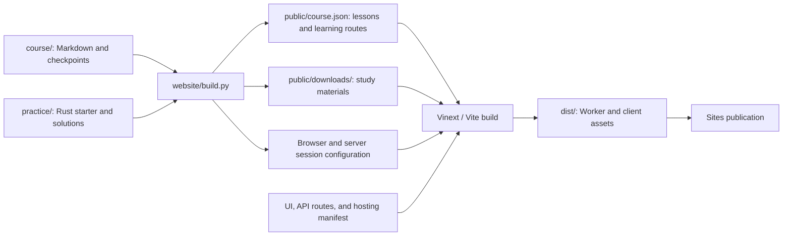
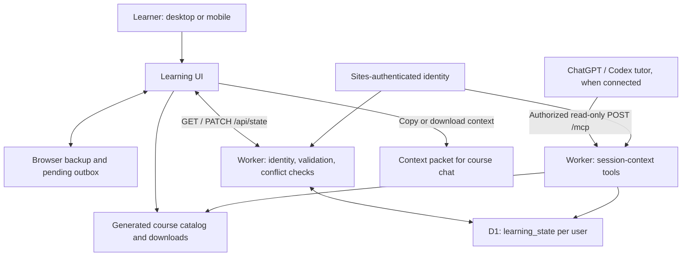

# Rust for AI Systems Engineers

Learn Rust through data pipelines, retrieval, agent infrastructure, backend services, Python integration, and measured optimization.

This English course is designed for an experienced Python data scientist / AI engineer moving into systems programming. Programming fundamentals and ML concepts are assumed; Rust ownership, resource management, and concurrency are introduced progressively.

**22 sessions · approximately 196 hours · 16 labs · 2 capstones**

[Open the Learning Studio](https://rust-ai-learning-kien.awarebream64.chatgpt.site/?revision=20261018-hybrid) · [Full syllabus](course/SYLLABUS.md) · [Session learning routes](course/LEARNING_PATHS.md) · [Research and sources](course/RESEARCH.md)

The hosted studio currently requires authorized account access. Course documents and practice sources can also be studied directly from this repository.

## What you will build

- Telemetry analysis and bounded JSONL ingestion for AI pipelines.
- A retrieval core with explicit numerical and ranking contracts.
- A bounded tool executor with deadlines, cancellation, retries, and shutdown.
- An HTTP inference gateway with streaming and observability.
- Python extensions and batched numerical interfaces.
- Reproducible performance experiments and an optimization engine.

The gateway, executor, extensions, and advanced optimization systems are learner projects described by lab contracts. They are not completed production implementations in this repository. Three foundation exercises include starter code and reference solutions.

## Course map

| Sessions | Track | Focus | Estimated time |
| --- | --- | --- | --- |
| 01–04 | Foundations | Types, ownership, borrowing, errors, traits, lifetimes, retrieval | 32 hours |
| 05–08 | Data and concurrency | Bounded ingestion, threads, async, backpressure, deadlines | 32 hours |
| 09–12 | Serving and integration | HTTP, streaming, tracing, Python bindings, gateway capstone | 32 hours |
| 13–18 | Advanced optimization | Profiling, allocations, layouts, Rayon, vectorization, exact top-k | 60 hours |
| 19–22 | Advanced optimization | Tail latency, numerical boundaries, compiler tuning, optimizer capstone | 40 hours |

Times are planning estimates. Spend additional time on concepts you cannot yet explain or apply; completing every linked external course is unnecessary.

## How to learn with AI

Each session provides a specific route:

1. **Study and repair:** trace a worked example, then fix or complete code.
2. **Probe the core:** explain a decision or implement a small essential function.
3. **Build with AI:** use assistance for scaffolding, implementation, tests, and refactoring.
4. **Verify and adapt:** check failure cases, diagnose a defect, and handle a changed constraint.

Only sessions **01–04, 08, 18, and 22** specify a short core implementation probe. A supplied signature/test harness, compiler, rust-analyzer, and API documentation are allowed. Other sessions use reasoning probes. There is no requirement to rebuild an entire project from a blank file.

Mastery means being able to **explain, make implementation decisions, verify/debug, and adapt**. AI-assisted code can qualify as Independent when these abilities are demonstrated. Record assistance separately from competence, and revisit a small variation later to check retention. See the [mastery method](course/MASTERY.md) and [assessment rubric](course/ASSESSMENT.md).

Use the course chat with three roles:

- **Teacher:** explain a mechanism and diagnose a misconception.
- **Teammate:** implement and investigate a blocker together.
- **Reviewer:** inspect code, tests, tradeoffs, and evidence.

The studio's **Work with me** section copies or downloads session context for your chat. An optional read-only Site MCP connection can expose the signed-in learner's session context. The website makes no OpenAI model API calls and requires no OpenAI API key. Compilation and execution happen in your local development environment.

## Start learning

Clone the repository:

```sh
git clone https://github.com/ttkien2035/rust-ai-learning.git
cd rust-ai-learning
```

1. Follow the [environment setup](course/SETUP.md).
2. Read Session 01 in the [lectures](course/LECTURES.md) and its [learning route](course/LEARNING_PATHS.md).
3. Work through the [lab contract](course/LABS.md), then review the [mastery challenge](course/MASTERY.md).
4. Keep decisions, errors, and evidence in your notes or [progress tracker](course/PROGRESS.md).

For the foundation crate, use stable Rust supporting edition 2024:

```sh
cd practice
cargo check
cargo test exercise_01
cargo test exercise_02
cargo test exercise_03
cargo test --features solutions
cargo fmt --check
cargo clippy --all-targets -- -D warnings
```

Starter functions deliberately contain `todo!()`: exercise tests fail until implemented. The `solutions` feature runs the same contract tests against reference implementations; it does not assess your unfinished starter code. Use a reference to study or compare behavior, then attempt a fresh focused variation when checking your own understanding.

Rust compilation and test execution were not verified during course preparation because no Rust compiler was discoverable. These are the commands for validating your local work, not a claim that they have already passed.

## Repository structure

```text
course/                 English lessons, learning routes, labs, and review criteria
practice/               Rust foundation crate: three exercises and reference code
website/                Learning Studio UI, backend, content generator, and tests
  app/api/state/        Authenticated learning-state API
  app/mcp/              Read-only tutor-context tools
  drizzle/              Database schema migrations
  public/               Generated course catalog, downloads, and browser assets
  build.py              Generate website assets from course/ and practice/
```

Useful references:

| Document | Purpose |
| --- | --- |
| [Workshops](course/WORKSHOPS.md) | Predictions, worked reasoning, staged practice, hints |
| [Core labs](course/LABS.md) | Input contracts and acceptance scenarios |
| [Advanced guide](course/ADVANCED.md) | Sessions 13–22 and optimization labs |
| [Gateway capstone](course/CAPSTONE.md) | Integration milestones and failure scenarios |
| [Performance report](course/PERFORMANCE_REPORT.md) | Workloads, measurements, uncertainty, adoption decisions |
| [Website documentation](website/README.md) | Architecture, authentication, synchronization, and tutor context |

## Website tech stack

| Layer | Technology | Role in this project |
| --- | --- | --- |
| Learning interface | HTML, CSS, vanilla JavaScript | Hash-based session navigation, lessons, practice, mastery, checkpoints, notes, and responsive layouts |
| Application framework | Vinext, Vite, TypeScript; React/Next-compatible project structure | Build the Worker application and serve API routes; the main learning interface is served from `website/index.html` |
| Content generation | Python 3, Python-Markdown | Compile authored Markdown and checkpoint data into the course catalog, downloads, and shared session configuration |
| Server runtime | Cloudflare Workers | Serve the application, learning-state API, and read-only tutor tools |
| Account identity | Sites-provided ChatGPT sign-in | Identify the learner on the server; local preview uses a development-only mock |
| Database | Cloudflare D1, SQLite | Store per-user progress, notes, checkpoint answers, and revisions |
| Schema tooling | Drizzle ORM / Drizzle Kit | Define the schema and generate committed SQL migrations; current state routes execute prepared D1 SQL directly |
| Browser persistence | `localStorage`, account-scoped pending outbox | Retain pending edits and browser backups across refresh and reconnect |
| Tutor integration | MCP over HTTP / JSON-RPC; context export | Expose authorized learning context to chat, or copy/download it without connecting a plugin |
| Verification | Node.js test runner, TypeScript, local HTTP integration tests | Check state merging, conflicts, validation, authorization, catalog boundaries, and API behavior |
| Hosting | Sites publication workflow | Publish the Worker build with its database binding and existing access policy |

Rust is the subject of the course and the language used in `practice/`; the learning website itself is built with the web stack above. The website does not compile Rust, run learner code, or call a model API.

## Website architecture

### Content and build pipeline



`course/` is the teaching source of truth. The generator combines core lectures, advanced lessons, workshops, session-specific learning routes, and mastery challenges into a 22-session catalog. It also generates limits shared by browser validation, backend validation, and the MCP schema. The frontend fetches this catalog; the MCP route imports it for tutor context.

Run `python build.py` before `npm run build`. Course text changes do not require a database migration when session IDs and saved-answer keys remain compatible. Database schema changes use a separate migration workflow.

### Runtime and learning-state flow



- **Content delivery:** `GET /` serves the learning HTML; browser scripts render routes such as `#session/12/mastery` from the generated catalog.
- **Account sync:** the server derives identity from the hosting platform. Each D1 row holds a user's state as JSON, a revision, and an update timestamp. Writes validate fields and require the same origin.
- **Concurrent edits:** changes carry their previous field values. Unrelated edits can merge; conflicting edits return a conflict for the learner to resolve. An atomic revision check handles concurrent database writes.
- **Reconnect behavior:** pending edits are backed up under the verified account in the browser and retried after reconnect. Foreground synchronization also polls periodically. Portable exports provide an additional backup.
- **Tutor context:** the MCP tools read the active session, a selected session, or progress after authorization. They cannot execute code or change completion state. Copy/download remains available when the plugin is not connected.

The database holds learning state; curriculum content is versioned in Git and generated at build time. The tutor runs in the existing chat, and the website cannot read that chat's separate history.

## Run the Learning Studio locally

Requirements: **Node.js 22.13+**, npm, and Python 3 with the `Markdown` package. Rust is needed for exercises, not for running the website.

From the repository root:

```sh
python -m pip install Markdown
cd website
npm run install:ci
python build.py
npm run build
```

Initialize the local D1 database after building:

```sh
node --import ./scripts/sites-env.mjs ./node_modules/wrangler/bin/wrangler.js d1 execute DB --local --config dist/server/wrangler.json --persist-to .wrangler/state --file drizzle/0000_motionless_night_thrasher.sql
npm run dev
```

Apply that initial schema only to a fresh local database. The dev server prints its local URL, normally `http://127.0.0.1:5173/`. Local preview provides a loopback-only simulated sign-in; hosted identity and account synchronization are supplied by Sites. A GitHub clone does not inherit hosted learner data or deployment access.

Edit the Markdown in `course/`, then rerun `python build.py` from `website/`. Generated files in `website/public/` are committed for delivery; change their source documents rather than editing generated lessons directly. The browser assets and catalog currently use a revision query in `index.html` and `app.js`; update that revision when publishing changed content to avoid stale caches.

Website checks, from `website/`:

```sh
node --test tests/learning.test.mjs tests/catalog.test.mjs
node node_modules/typescript/bin/tsc --noEmit
node tests/http.test.mjs
```

The HTTP checks require the running local dev server and initialized local database. They exercise local authentication, persistence, conflicts, and MCP context, and restore the local test note. They do not test Rust or modify hosted learner data.

## Hosting and source workflow

The published studio uses an HTML/CSS/JavaScript interface, Vinext on Cloudflare Workers, and D1 account storage. It includes responsive lessons, checkpoints, notes, account sync, and learning-data exports. Progress completion and mastery labels are self-assessed, not automatic certification. It is not an offline PWA.

GitHub stores the course source. Publishing the existing hosted site is a separate Sites workflow; pushing to GitHub alone does not deploy it. Preserve the existing project identity and audience in `website/.openai/hosting.json` when updating that site.

On the original development machine, `website/` also has its own local Git metadata for Sites. The outer repository tracks actual website files, not a submodule; that nested metadata is not included in GitHub clones. Keep the two source histories distinct when working from the original checkout.

## Sources and scope

The curriculum combines official Rust and library documentation with author-maintained courses and programming-education research. See [RESEARCH.md](course/RESEARCH.md) for sources, evidence limits, and the learning-design revision dated **18 October 2026**.

Mock services and synthetic datasets are sufficient for the course. Performance gains are hypotheses to measure, not promised outcomes. Follow upstream licenses when reusing linked materials; vendored website assets retain their included license notices.
